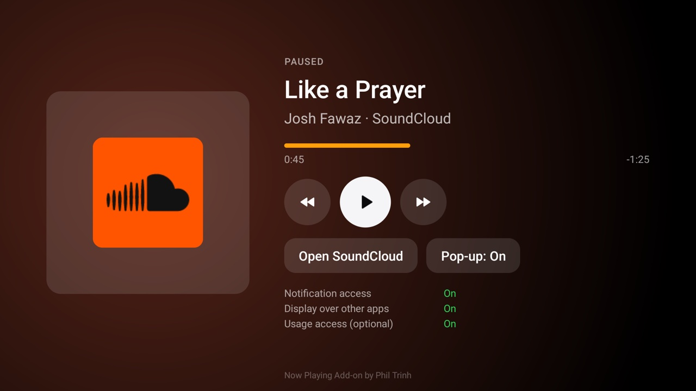

# Now Playing

What is playing in the background, and the controls for it, in the Apple TV style: start music in an app,
press Home, and the track keeps going while you browse. Open the **Now Playing** card to see the artwork,
title, artist and app with the progress, and Previous, Play/Pause and Next. When a new track starts while
another app is in front, a small pop-up shows it in the top right corner for six seconds. For the
[Clean Your TV](../../README.md) launcher it declares a [module card](../../docs/modules.md): once you answer
**Show card** its tile reads "Now Playing" with a coral glow. On any other Android TV home it is an ordinary
app.

It comes from the launcher fork [github.com/ptrinh/tvhome-remote](https://github.com/ptrinh/tvhome-remote),
where Now playing is a card drawn on Home itself. An add-on can't draw inside the launcher (the module card
is the app's tile with a fixed label, caption and glow), so here it is the card's own screen plus the
pop-up, with no change to the launcher.



## What it shows

| Where | What |
|---|---|
| **The card screen** | The artwork (or the app's icon when the app sends none) with a glow in its colour, NOW PLAYING or PAUSED, the title, "artist · app", an orange progress line with the time gone and the time left (LIVE for a stream with no length), and three round buttons: Previous, Play/Pause, Next. **Open *app*** goes to the playing app's own player. **Pop-up: On/Off** switches the pop-up. Three lines at the bottom say what install.sh granted. |
| **The remote** | On the card screen, OK on a button, and the remote's own play/pause, next and previous keys act on the track shown. Everywhere else the media keys go to the playing app as Android always sends them; the add-on doesn't touch them. |
| **The pop-up** | A glass pill with the artwork, NOW PLAYING, the title, "artist · app" and the orange progress line moving, over whatever is on screen, for six seconds when a new track starts playing. Not when you pause and play again, not while the card screen is open, not with the screen off, and (with usage access) not while the music app itself is on screen. It never takes focus or touches: the remote keeps working in the app underneath. |

Which track: Android's media sessions, most recently active first. The first one playing wins, else the first
one paused; with none, the card says Nothing playing.

## Setup

JDK 17 and Android SDK 34 to build, as for the launcher, and the `tools/venv` from the main README. Android 8
or later.

1. **Install** it with ADB on, from the repo root:

   ```bash
   TV_HOST=<tv ip> addons/now-playing/install.sh
   ```

   (Windows: `addons\now-playing\install.ps1 -TvHost <tv ip>`.) It builds the APK if there is none
   (`cd addons/now-playing && ./gradlew assembleRelease`), installs it and grants what it needs, saying what
   each is for (see Permissions). Add `--no-usage` (`-NoUsage`) to leave out the optional usage access.
2. **Play some music** in an app that keeps playing in the background, and press Home.
3. **Open the card.** Press Home and answer **Show card** for the card; change the answer later by holding OK
   on Settings, then Module cards.

Without install.sh: Settings › Apps › Special app access › **Notification access** › Now Playing, and
**Display over other apps** › Now Playing, where the TV has those pages (many TVs hide them; the card screen
has an **Open settings** button when the first one exists).

The JVM tests (which session is shown, the two lines, position and progress, the times, when the pop-up
shows, the glow colour) run with `./gradlew testReleaseUnitTest`. The release build is signed with the debug
key so it installs over ADB like the launcher. Uninstall with
`TV_HOST=<tv ip> addons/now-playing/install.sh --uninstall`.

## Permissions

| Permission | Why |
|---|---|
| Notification access (`SessionListener`, a `NotificationListenerService`) | Android lists other apps' media sessions (`MediaSessionManager.getActiveSessions`) only to an app with an enabled notification listener, and keeps that listener bound, so it is also where the pop-up waits for a new track. **It reads no notifications**: none of the notification callbacks are used. Enabled by install.sh (`cmd notification allow_listener`; on Android 8.0 by adding it to `enabled_notification_listeners`, keeping the others). Without it the card says Needs notification access and nothing else happens. |
| Display over other apps (`SYSTEM_ALERT_WINDOW`) | The pop-up (`TYPE_APPLICATION_OVERLAY`, not focusable, not touchable). Granted by install.sh (`appops set … SYSTEM_ALERT_WINDOW allow`), since many TVs hide the setting. Without it the card works and nothing pops up. |
| Usage access (`PACKAGE_USAGE_STATS`, `GET_USAGE_STATS` app-op), optional | Which app is on screen, read only when a new track would pop up, so there is no pop-up over the music app itself. Granted by install.sh unless `--no-usage`. Without it the pop-up shows for every new track. |

No network permission, no foreground service, no start at boot, no wake locks: the listener reacts to the
media sessions' own callbacks. install.sh also allows TCL's auto-start op where it exists, so the system binds
the listener after a reboot on those TVs. The app looks up the playing app's name and icon (package
visibility for launcher apps and media browser services).

## Privacy

- **Nothing leaves the TV.** No network permission, no telemetry, no ads, no accounts, no libraries in the
  APK.
- **No notifications are read**, and no track is stored: the card and the pop-up show the current one and
  forget it. The only thing saved is the pop-up switch, in the app's private storage (backups are off).
- Usage access is read on the TV only, for the one question above, and only when you granted it.

## Limits

- **Apps that publish no media session** (some video players, some TV apps) don't show up: there is nothing
  for Android to list. Most music, radio and podcast apps publish one.
- **Previous and Next** do what the app does with them; some apps (radio, live streams) ignore them.
- **The pop-up can't take remote keys**: an overlay that took focus would steal the remote from the app
  underneath. Use the remote's media keys, or the card screen.
- **On Home the card is the add-on's tile**, with its fixed label and glow, not the track: spec 1 module
  cards can't change what the launcher draws.
- **Aggressive memory managers** on 1 GB TVs may unbind the listener; the system binds it again, and opening
  the card works either way.

## Tested on

Sony BRAVIA 4K AE2 (Google TV 14), with SoundCloud playing in the background, on 25 Oct 2026:

- The three grants (notification access, overlay, usage access) show On on the card screen.
- The card screen shows the title, "artist · app", the app's icon on a glass tile when the app sends no
  artwork, and the orange progress with the time gone and left.
- The remote's play/pause key pauses and plays (PLAYING → PAUSED → PLAYING), and next skips.
- From Home, a new track pops up in the top right corner with its progress and is gone after six seconds; the remote keeps
  working on Home underneath.
- Nothing playing (YouTube drops its session once it is in the background): the card says Nothing playing.

## Maintainer

[@ptrinh](https://github.com/ptrinh)
